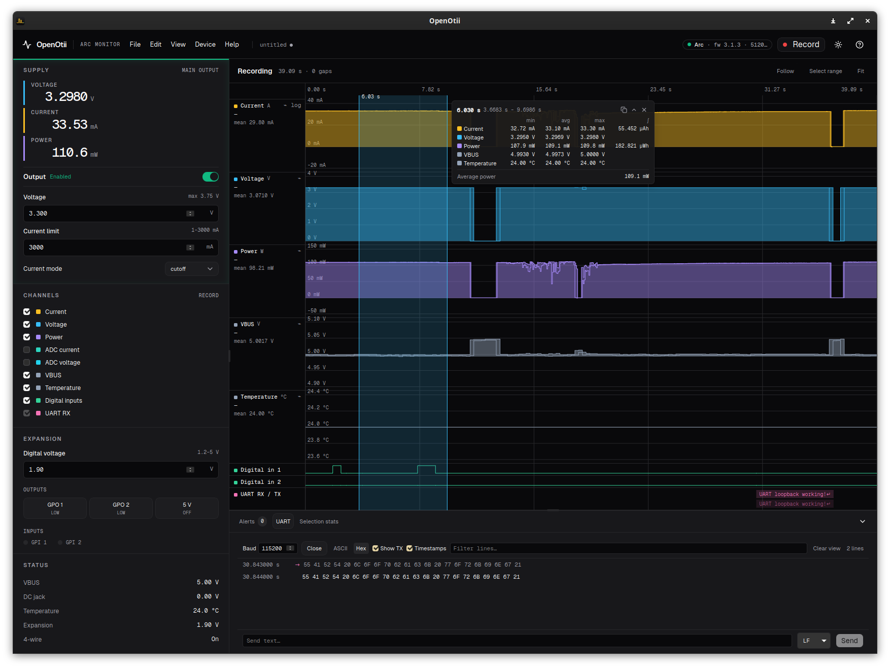

# Benchwatt

An open-source desktop app, command line tool and Python package for bench
power instruments, on Linux. One program to set the supply, record current and
voltage, look at the result, and script measurements in CI.

It talks to each instrument directly over USB. You don't need the vendor's
desktop app, an account or a license.

| Instrument | What Benchwatt uses it for |
|------------|----------------------------|
| [Qoitech Otii Arc](https://www.qoitech.com/otii-arc-pro/) | Supply, current/voltage/power at 4 kHz, digital I/O, UART |
| GW Instek GPP-1326, GPP-2323, GPP-3323, GPP-4323 | Up to four supply outputs with voltage, current and power readings, OVP and OCP |
| Nordic Power Profiler Kit II | Supply or ampere meter, current at 100 kHz, eight digital inputs |
| [Joulescope JS220](https://www.joulescope.com/products/js220-joulescope-precision-energy-analyzer) | Inline meter: current, voltage and power at 10 Hz to 1 MHz, two digital outputs |

This is an independent project. It isn't affiliated with or supported by
Qoitech, GW Instek, Nordic Semiconductor or Jetperch.



## What works

- **Power supply**: output on/off, voltage and current limit for every output
  of every connected instrument, plus whatever else the instrument has to set
  (the Arc's cutoff or constant-current limiting, the GPP's OVP and OCP, the
  PPK2's mode, the Joulescope's sample rate and current range). Alerts such as
  over-current are shown as they happen.
- **One instrument at a time**: the app lists every supported instrument that
  is plugged in, in the top bar and under the Device menu, and opens the one
  you pick. The others stay free for other programs. Outputs are shown in the
  colours of the front panel where there are any, so CH2 of a GPP-4323 is cyan
  on screen too.
- **Recording**: any of the instrument's channels: current, voltage and power,
  digital inputs, and on the Arc also the ADC, VBUS and temperature channels
  and UART RX/TX. Recordings are kept in memory with a min/max pyramid, so
  zooming from an hour down to single samples stays fast.
- **Tabs**: every recording gets a tab of its own, and so does every file you
  open. Earlier runs stay there to compare with until you close them.
- **Viewer**: one lane per channel, with a shared time axis. Wheel to zoom,
  drag to pan, shift-drag to select. A selection shows min/avg/max, charge and
  energy right next to it.
- **UART console** (Arc): a line-based log of what the device sent and what
  you typed. Clicking a line jumps to that moment in the plot, and selecting a
  range in the plot highlights the matching lines.
- **Digital I/O**: the Arc's GPO1–2, GPI1–2, 5 V pin and I/O voltage; the
  PPK2's eight inputs.
- **Files**: save and open `.bwrec` recordings, export to CSV or to a
  sigrok session (`.sr`) for PulseView.
- **Automation**: the `benchwatt` command line tool and the `benchwatt` Python
  package, both described below.

Tested with an Arc (hardware 1.3, firmware 3.1.3), a GPP-4323 (firmware V1.16),
a PPK2 and a JS220 (firmware 1.3.0). The other GPP models are driven from their manuals and have not
been on our bench. The Otii Ace and older Arc firmware are not supported; if
your Arc still runs firmware 1.x, update it with the Otii app first.

## Getting started

You need Rust (stable), Node.js 22 or newer, and the
[Tauri prerequisites for Linux](https://v2.tauri.app/start/prerequisites/#linux)
(webkit2gtk and friends). The Joulescope support builds Jetperch's driver from
source, which takes CMake, a C compiler, clang (for the bindings) and the
libudev headers (`libudev-dev` on Debian/Ubuntu; part of `systemd-libs` on
Arch). The driver is a git submodule:

```sh
git clone --recurse-submodules https://github.com/maximevince/benchwatt.git
# or, in a clone you already have:
git submodule update --init
```

Your user needs access to the instruments' serial ports. On most distributions that
means being in the `uucp` or `dialout` group:

```sh
sudo usermod -aG uucp $USER   # or dialout on Debian/Ubuntu; log in again afterwards
```

The Joulescope is not a serial port. It needs the udev rule that comes with
its driver:

```sh
sudo cp crates/jsdrv-sys/joulescope_driver/72-joulescope.rules /etc/udev/rules.d/
sudo udevadm control --reload-rules   # then plug the Joulescope in again
```

Build the interface once, then run the app:

```sh
cd app && npm install && npm run build && cd ..
cargo run --bin benchwatt-app
```

The interface in `app/dist` is built into the binary, so run `npm run build`
again after changing anything under `app/src`. While working on the interface,
`cd app && npm run tauri dev` is more convenient: it reloads as you edit.

It finds the instruments on its own by their USB ids. With one plugged in it
opens that one; with several you choose, and it remembers the choice. A chosen
instrument is picked up again when you plug it back in. Only one program can
hold an instrument, so choose Device → Disconnect (or close the app) before
using the command line tool on the same one. `npm run tauri build` produces a `.deb` and an AppImage under
`target/release/bundle/`.

Any serial port of the PC can be recorded next to the instrument: choose it in
the Serial tab of the bottom panel, or under Device → Serial port, and open
it. What the target prints then lands in the console and on the time axis of
the recording, and you can type back. This gives a GPP or a PPK2 what the Arc's
own UART does. Parity, stop bits, flow control and the DTR and RTS lines are
behind the small button next to the baud rate. A recording takes its text from
one place, the instrument's UART or a serial port. The PC stamps the bytes
when it reads them, so they sit within some milliseconds of the current trace
(a USB adapter may hold bytes back; FTDI ones for up to 16 ms), which is
enough to tell which log line goes with which current peak.

Without any hardware, `cd app && npm run dev` serves the interface at
<http://127.0.0.1:1420> with a simulated Arc. Add `?devices=arc,gpp,ppk2` to
the address for a simulated GPP-4323 and PPK2 as well. This is handy for
working on the UI.

## Command line


```sh
cargo build --release -p benchwatt-cli
./target/release/benchwatt devices
./target/release/benchwatt info
```

`devices` lists what is plugged in. With one instrument connected every
command uses it; with several, name one with `--device arc`, `--device gpp`,
`--device ppk2` or `--device joulescope`.

Some examples with an Arc:

```sh
benchwatt power --volt 3.3V --ilim 100mA on
benchwatt measure --ch mc,mv,mp --duration 10s
benchwatt record --ch mc,mv,mp --gpi --uart 115200 --duration 30s -o boot.bwrec
benchwatt convert boot.bwrec boot.sr
benchwatt stats boot.bwrec --from 2s --to 5s
benchwatt power off
```

With an instrument that has no UART, record a serial port of the PC instead:

```sh
benchwatt --device gpp record --ch ch1.i --serial /dev/ttyUSB1:115200 --duration 30s -o boot.bwrec
```

`mc`, `mv` and `mp` are the Arc's names for main current, voltage and power.
Values take units (`3.3V`, `50uA`, `100ms`). Output is meant for people by
default; add `--json` to get JSON instead.

On a supply with several outputs you say which one, and `power` on its own
shows them all:

```sh
benchwatt --device gpp power --out 2 --volt 5V --ilim 500mA on
benchwatt --device gpp measure --ch ch2.v,ch2.i,ch2.p --duration 10s
benchwatt --device gpp power
```

`measure` and `record` can also power the target themselves and switch it off
again when they are done. The PPK2 needs this form, because it switches its
output off as soon as a command ends:

```sh
benchwatt --device ppk2 measure --ch i --duration 5s --volt 1.8V --on --settle 1s
```

A Joulescope sits in the supply line of the target and can interrupt it. Its
current range decides: `off` opens the line, `auto` or a fixed range closes it.

```sh
benchwatt --device joulescope set range auto
benchwatt --device joulescope measure --ch i,v,p --duration 5s
```

### Power checks in CI

`measure` accepts assertions and exits with status 1 if any of them fails. A
hardware-in-the-loop job can then guard against power regressions with a
couple of lines:

```sh
benchwatt power --volt 3.3V --ilim 100mA on
benchwatt --json measure --ch mc,mv,mp --duration 10s \
  --assert 'mc.mean<50uA' --assert 'mc.max<=200mA' --assert 'charge<0.1mAh' \
  > power.json
status=$?
benchwatt power off
exit $status
```

Exit codes are 0 (pass), 1 (an assertion failed), 2 (device or file error) and
3 (bad arguments). See [docs/cli.md](docs/cli.md) for everything else.

## Python

```python
import benchwatt

print(benchwatt.devices())        # what is plugged in

with benchwatt.open("arc") as arc:   # or benchwatt.open() with a single instrument
    arc.set_voltage(1.8)
    arc.set_current_limit(0.05)
    arc.output = True
    rec = arc.record(5.0, channels=["mc", "mv", "mp"])
    arc.output = False

print(rec.stats("mc"))            # mean, min, max, rms, ...
t, i = rec.data("mc")             # NumPy arrays
rec.save("run.bwrec")

with benchwatt.open("gpp") as gpp:
    gpp.set_voltage(5.0, out=2)
    gpp.set_output(True, out=2)
```

Build it with maturin from `crates/benchwatt-py`. Recordings saved by the app, the
CLI or Python open in any of the three. Details and a pytest example are in
[docs/python.md](docs/python.md).

## Repository layout

| Path | What's in it |
|------|--------------|
| `crates/benchwatt-device` | What a device looks like to the rest: channel descriptions, sample blocks, capability traits |
| `crates/otii-arc` | The Arc's protocol and serial driver, and its adapter to those traits |
| `crates/benchwatt-gpp` | Driver for the GW Instek GPP supplies (SCPI over the USB serial port) |
| `crates/benchwatt-ppk2` | Driver for the Nordic PPK2 |
| `crates/benchwatt-joulescope` | Driver for the Joulescope JS220, on top of the vendor's driver |
| `crates/jsdrv-sys` | Builds Jetperch's `joulescope_driver` (a submodule) and declares its C interface |
| `crates/benchwatt-rec` | Recording engine, `.bwrec` format, CSV and sigrok export |
| `crates/benchwatt-session` | Opens devices and runs captures into a recording |
| `crates/benchwatt-cli` | The `benchwatt` command line tool |
| `crates/benchwatt-py` | Python bindings (PyO3) |
| `app/` | Desktop app: Tauri 2 backend, Svelte 5 frontend |
| `docs/PROTOCOL.md` | The Arc's v3 protocol as far as we know it |
| `fixtures/` | Captured device traffic used in tests |

Adding an instrument means writing one driver crate against
`benchwatt-device` and adding it to the list in `benchwatt-session`. The
command line tool, the Python package and the app build what they show from
the driver's description of its channels, outputs and settings.

## The protocols

Qoitech doesn't document the Arc's USB protocol. `docs/PROTOCOL.md` describes what
we found by reading the vendor application and testing on hardware: framing,
commands, properties, the data packet format and a list of quirks. Entries
marked `[V]` have been verified on a real Arc. Corrections are welcome,
especially from people with other hardware or firmware versions.

The GPP supplies speak SCPI as described in GW Instek's manual. The PPK2
driver is written from the published facts about its serial protocol; it
contains no code from Nordic's application or from other PPK2 libraries.

The Joulescope is driven through Jetperch's own
[joulescope_driver](https://github.com/jetperch/joulescope_driver)
(Apache-2.0), which is linked into the program together with the libusb
(LGPL-2.1-or-later), miniz (MIT) and tinyprintf (BSD-3-Clause) it bundles.
Their licence texts are in `crates/jsdrv-sys/joulescope_driver/LICENSES`.
`crates/jsdrv-sys/patches` holds the fixes we build it with. To build without
it, and without CMake, turn off the `joulescope` feature of
`benchwatt-session`.

A few settings the Arc stores in calibration are never written by this code.
Even so, this is unofficial software driving power supplies: double-check
voltage and current limits before you connect something you care about.

## Development

```sh
cargo test --workspace
cargo clippy --workspace --all-targets -- -D warnings
cd app && npm run check && npx vitest run
```

Hardware tests are skipped unless you opt in, and each one is skipped when its
instrument isn't plugged in. The Arc tests expect a 100 Ω load on the main
output and the expansion port wired TX→RX and GPO1→GPI1. The GPP and PPK2
tests only set a voltage with the output off, and the Joulescope test only
measures:

```sh
BENCHWATT_HW=1 pytest crates/benchwatt-py/tests/hw
cargo run -p benchwatt-session --example live
```

## License

Benchwatt is free software: you can redistribute it and/or modify it under the
terms of the GNU General Public License as published by the Free Software
Foundation, either version 3 of the License, or (at your option) any later
version. See [LICENSE](LICENSE).
